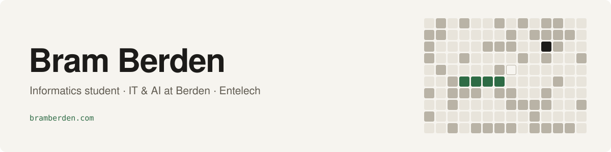

<picture>
  <source media="(prefers-color-scheme: dark)" srcset="assets/banner-dark.svg">
  
</picture>

I study Informatics at Fontys and lead IT and AI at Berden, a retail company where I started as an IT engineer two years ago. I also started [Entelech](https://entelech.ai): we build AI that fits into the systems companies already use.

The question I keep coming back to is how companies can get the most out of AI. They don't need better models. They need to know how to use the ones that exist to their full potential, within the law and safely.

## What I've been working on

<b>Who pays when something breaks in a rented building?</b>

 

An agent that reads the maintenance ticket, checks the lease and the Dutch rules on small repairs, finds a supplier and books the cost.

Entelech, 2026

<b>How do you let a language model use a company's core system without letting it touch the books?</b>

 

An MCP server that turns 203 API operations into 30 tools, logs every call and keeps writes to the ledger off by default.

Entelech, 2026

<b>Can IT for 550 people change only through pull requests?</b>

 

Microsoft 365 and the firewall as code, tested with Maester before anything goes live.

Berden, 2026

<b>Does a four in a row turn up before a five?</b>

 

A Monte Carlo [simulation](https://github.com/b-brd/grid-simulation) that plays millions of games on a 12 × 12 grid. It runs live on [bramberden.com](https://bramberden.com).

Lab, 2026

Most of this lives in private company repositories. What I can share ends up here and in the [lab](https://bramberden.com/lab).

## Interested in

**At work**
- Agents that run a real process from start to finish
- Connecting language models to the systems companies already have (MCP)
- Evaluation: knowing whether a model actually works before it ships
- Using AI within the law: GDPR, EU hosting, the EU AI Act
- Infrastructure as code for whole organisations

**Beyond work**
- Simulation and probability
- Complex systems
- Philosophy, especially of mind and intelligence
- Entrepreneurship

## Tools I use most

Python · TypeScript · C · SQL · PyTorch · Keras · scikit-learn · LightGBM · Claude, OpenAI and Gemini APIs · Microsoft 365 and Azure · Docker · Linux · Cloudflare

## Elsewhere

[bramberden.com](https://bramberden.com) · [LinkedIn](https://www.linkedin.com/in/bramberden/) · hello@bramberden.com

From February 2027 I'm looking for a 20-week internship.
